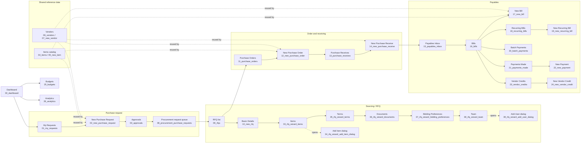

# Zoho Procurement — UI/UX Agent Handoff

**Audience:** frontend/UI/UX implementation agent
**Scope:** Zoho Procurement capture set, 118 screenshots.
**Reference files:** `README.md` (capture index), `capture_manifest.csv` (one row per image), and the PNGs in this folder.

> **Implementation principle:** model workflows as paths through reusable screens, not as separate copies of every page. A workflow step should reference a canonical screen and pass context (role, selected record, source workflow, and permitted actions). Create a new screen only when the user task or role actually changes the information architecture or behavior.

## 1. How to use this handoff

1. Start from the workflow maps below to understand the user journey and where a screen is entered/exited.
2. Open the referenced screenshot to inspect visual hierarchy and controls. The filename is the screenshot ID; the manifest gives the full page/state label for all 118 images.
3. Build one canonical screen/component for each page type, then connect multiple workflows to it with context and state.
4. Treat screenshots as product references, not as a demand to reproduce demo data, tenant labels, or every control literally. Use product data and permissions to determine the runtime state.

Screenshots are linked relative to this guide, for example [Purchase Orders list](./11_purchase_orders.png). The screenshot set is a point-in-time view of the demo tenant; values and enabled features may differ in another organization.

## 2. Product-level navigation model

The captured app uses a common shell with global search, account/profile controls, notification/support affordances, module navigation, and a persistent bottom utility bar. Keep this shell shared across all module pages.

Suggested information architecture:

- **Home:** dashboard and spend overview.
- **Purchase Requests:** employee-facing requests, approvals, and Procurement-side request management.
- **Procurement:** RFQs, Purchase Orders, Purchase Receives, shared Items and Vendors.
- **Payables:** inbox, Bills, Recurring Bills, Batch Payments, Payments Made, Vendor Credits.
- **Budgets / Analytics:** budget monitoring and reporting.
- **Settings:** organization, configuration, module preferences, automation, templates, email notifications.

The captured product includes role-oriented pages and support/settings pages. Use the user’s permission set to control visibility and actions; do not hide the employee request experience merely because the Procurement team has a different management view.

## 3. End-to-end workflow map



The arrows represent product relationships, not a hard requirement that every tenant follows exactly this sequence. For example, a bill may enter through the Inbox or be created directly; a purchase request may proceed to sourcing or stop after approval.

## 4. Workflow specifications and screenshot references

### A. Purchase request and approval

**Screens:** [01 My Requests](./01_my_requests.png) → [02 New Purchase Request](./02_new_purchase_request.png) → [03 Approvals](./03_approvals.png) → [08 Procurement Purchase Requests](./08_procurement_purchase_requests.png).

**What happens:** an employee reviews their requests, starts a request, and submits it for review. Approvers work from the approvals area. Procurement has a separate management queue for downstream purchasing/sourcing. The two request lists are different role views of related records.

**Frontend guidance:** implement one request entity/state model and permission-aware views. The employee view and Procurement queue can share row/detail components, but should have distinct role-specific actions, filters, and navigation. Avoid creating a second “new request” implementation merely because a request can also be opened from the Procurement queue.

**My Requests tabs and scope:** the supplied crop is documented in [REFERENCE_REQUEST_VIEWS.md](./REFERENCE_REQUEST_VIEWS.md). Keep **Pending Requests** and **All Requests** as status views, separate from the **My Requests / All Requesters** scope added in the prototype. Show requester identity in all-requester results. This demo filter uses fictional browser-local owners and is not an authorization boundary; Procurement and Approvals remain separate role-specific queues.

**Related shared data:** Items (`04`, `05`) and Vendors (`06`, `07`) are shared directories/forms, not request-specific pages.

### B. RFQ sourcing wizard

**Screens:** [09 RFQ list](./09_rfqs.png); [10 Basic Details](./10_new_rfq.png); [33 Items](./33_rfq_wizard_items.png); [34 Add Item dialog](./34_rfq_wizard_add_item_dialog.png); [35 Terms](./35_rfq_wizard_terms.png); [36 Documents](./36_rfq_wizard_documents.png); [37 Bidding Preferences](./37_rfq_wizard_bidding_preferences.png); [38 Team](./38_rfq_wizard_team.png); [39 Add User dialog](./39_rfq_wizard_add_user_dialog.png).

**What happens:** a user opens the RFQ list and starts an RFQ. The wizard proceeds through basic details, line items, terms, documents, bidding preferences, and team/organizer. The Items stage can open an item-selection/add-item subflow; the Team stage can open an Add User subflow. The capture uses an existing demo item (`test 1`) for the line-item state; no vendor invitation or publication was done.

**Frontend guidance:** build a single RFQ wizard shell with a stepper and one stage component per step. Keep a draft model across stages; opening a dialog must not create an independent workflow. The Basic Details screen is shared with screenshot `10_new_rfq.png`—do not build a second Basic Details page for “wizard step 1.” The wizard should support back/next, draft-save, validation, and exit/resume states, with publish/send as a separate explicit action.

### C. Purchase Orders

**Screens:** [11 Purchase Orders list](./11_purchase_orders.png) → [12 New Purchase Order](./12_new_purchase_order.png).

**What happens:** a user reviews orders or creates an order with vendor, delivery destination, order/reference numbers, dates, payment terms, shipment preference, tax treatment, item/account lines, notes, terms, and optional attachments. The form exposes separate draft-save and send actions.

**Frontend guidance:** use the shared transaction editor and shared vendor/item/tax/account pickers. Do not create a separate item table for every transaction type; parameterize columns, tax behavior, totals, and validation rules. Keep **Save as Draft** distinct from **Save and Send**.

### D. Purchase Receives

**Screens:** [13 Purchase Receives list](./13_purchase_receives.png) → [14 New Purchase Receive](./14_new_purchase_receive.png).

**What happens:** the user records goods received, typically tied to a purchase order. The receive workflow must capture the source order, received quantities, dates, and any required notes/attachments; a receipt changes inventory/receiving state, so the screenshot capture did not submit one.

**Frontend guidance:** reuse the transaction list/detail shell and line-item component, but provide receive-specific quantities/statuses and source-order context. Do not reuse the New Purchase Order form as the receive form.

### E. Payables Inbox and Bills

**Screens:** [15 Payables Inbox](./15_payables_inbox.png) → [16 Bills list](./16_bills.png) → [17 New Bill](./17_new_bill.png).

**What happens:** bills may enter through an inbox/intake experience, then be reviewed in Bills or created manually. A bill includes vendor, dates/references, item/account lines, taxes, totals, notes, attachments, and save/submit actions. Bill reconciliation is configurable in settings (`79_settings_bills_preferences.png`).

**Frontend guidance:** keep bill intake and the Bills ledger as related but distinct screens. Reuse the vendor picker, line editor, tax controls, totals summary, and attachment component; do not clone the purchase-order editor wholesale because its reconciliation and receiving relationships differ.

### F. Recurring Bills

**Screens:** [18 Recurring Bills list](./18_recurring_bills.png) → [19 New Recurring Bill](./19_new_recurring_bill.png); notification template [68 Recurring Bill email](./68_email_recurring_bill.png).

**What happens:** a user configures a bill template plus schedule/frequency and recurrence boundaries. It is a reusable schedule for future bills, not the same state as a one-off bill.

**Frontend guidance:** use the common bill editor for shared financial fields, composed with a recurrence panel. Keep recurring schedule state separate from the generated bill records and make schedule status/next run visible.

### G. Payments and batch payments

**Screens:** [20 Batch Payments](./20_batch_payments.png), [21 Payments Made](./21_payments_made.png) → [22 New Payment](./22_new_payment.png); PDF/email configuration [51](./51_settings_pdf_vendor_payments.png) and [70](./70_email_payment_made.png).

**What happens:** Payments Made lists recorded payments; New Payment records a payment against a vendor/bill; Batch Payments is a separate grouping/processing entry point. The screenshot set did not submit a payment or run a batch.

**Frontend guidance:** reuse payment-method, account, amount, vendor, and bill-selection components. Do not conflate a batch workspace with the individual payment form, and keep payment execution/confirmation separate from data entry.

### H. Vendor Credits

**Screens:** [23 Vendor Credits list](./23_vendor_credits.png) → [24 New Vendor Credit](./24_new_vendor_credit.png); related settings include [50 PDF template](./50_settings_pdf_vendor_credits.png) and [63 email notification](./63_email_vendor_credit.png).

**What happens:** the user creates/reviews a vendor credit that can later be applied to a payable. It is a distinct financial document, not a bill or payment.

**Frontend guidance:** reuse vendor, line-item, tax, totals, and attachment components, but provide credit-specific status and application actions.

### I. Shared reference data, budgets, and analytics

- **Items:** [04 directory](./04_items.png), [05 New Item](./05_new_item.png). Use as the single item catalog; invoke the same picker in requests, RFQs, orders, bills, and credits.
- **Vendors:** [06 directory](./06_vendors.png), [07 New Vendor](./07_new_vendor.png). Use one vendor directory/picker across procurement and payables.
- **Budgets / analytics:** [25 Budgets](./25_budgets.png), [26 Reports Center](./26_analytics.png). These are supporting monitoring/reporting destinations; they should not be embedded as duplicate summaries inside every transaction screen.
- **Dashboard:** [00 Dashboard](./00_dashboard.png) is the overview entry point and should link into the canonical module screens rather than reimplementing them.

## 5. Reuse blueprint: one canonical screen, many workflow references

| Canonical UI building block                                                         | Screenshot references                                                                                 | Reuse in                                                                                                            |
| ----------------------------------------------------------------------------------- | ----------------------------------------------------------------------------------------------------- | ------------------------------------------------------------------------------------------------------------------- |
| Application shell, navigation, search, utilities                                    | Any full page; especially `00_dashboard.png`, `27_settings_index.png`                                 | All modules                                                                                                         |
| List/table view (filters, sort, empty state, row actions)                           | `01`, `08`, `09`, `11`, `13`, `16`, `18`, `20`, `21`, `23`                                            | Different data modules using one configurable list framework                                                        |
| Transaction editor shell (header, metadata, line items, totals, notes, attachments) | `02`, `12`, `14`, `17`, `19`, `22`, `24`                                                              | Purchase requests, orders, receiving, bills, recurring bills, payments, credits—with module-specific fields/actions |
| Vendor selector and vendor detail/reference form                                    | `06_vendors.png`, `07_new_vendor.png`                                                                 | Requests, RFQs, orders, receipts, bills, payments, credits                                                          |
| Item catalog, item picker, item editor                                              | `04_items.png`, `05_new_item.png`, `34_rfq_wizard_add_item_dialog.png`                                | Requests, RFQs, orders, bills, recurring bills, credits                                                             |
| Approval state/view                                                                 | `03_approvals.png`, plus module approval settings such as `73_settings_purchase_orders_approvals.png` | Purchase requests, orders, payments where enabled                                                                   |
| Wizard shell/stepper and nested dialog                                              | `10`, `33`–`39`, `113`–`116`                                                                          | RFQ setup and settings builders; stage content remains configurable                                                 |
| Settings shell, module tabs, field/rule/button builders                             | `27`, `72`–`91`, `109`–`112`                                                                          | Organization settings and module-specific customization                                                             |
| Automation editor and selector components                                           | `96`–`99`, `113`–`120`                                                                                | Workflow rules, alerts, schedules; do not execute from screenshot-only flows                                        |
| Notification-template editor/category page                                          | `53`–`71`, plus PDF template pages `47`–`52`                                                          | One template management UI keyed by notification/document type                                                      |

### Shared list tools and file workflows

Use one list/table toolbar configured by module. The user-supplied Vendor screenshot and the sanitized follow-up note in [REFERENCE_LIST_CONTROLS.md](REFERENCE_LIST_CONTROLS.md) supplement the original `06_vendors.png` capture. Preserve the **Active Vendors** saved view, quick search, Advanced Search fields, sort menu, row selection, Customize Columns/Clip Text, and More Actions structure. The Vendor More Actions menu includes Sort by, Import, Export, Preferences, Refresh List, and Reset Column Width; Preferences navigates to the existing Vendor settings screen instead of creating a duplicate page.

Vendor **Import** opens a choice between Vendors and Vendor's Contact Persons, then a shared Configure → Map Fields → Preview wizard. Vendor **Export** exposes Export Vendors, Export Current View, and (when rows are selected) Export Selected. Apply these controls across relevant catalog/transaction lists with entity-specific fields and actions. This frontend's import/export operates only on browser-local demo records; it parses CSV/TSV locally and displays the XLS limitation, and it must never call Zoho or download live tenant records.

### Navigation/state model recommendation

Use stable screen identifiers (examples below), with workflow context separate from the screen:

```json
{
  "screenId": "purchase-order.editor",
  "workflowId": "purchase-to-pay",
  "entryPoint": "rfq.awarded",
  "recordId": null,
  "returnTo": "purchase-orders.list",
  "permissions": ["purchase_order.create", "purchase_order.draft"]
}
```

This lets an RFQ award and a direct “New Purchase Order” action open the same editor with different prefilled context. The page is not duplicated; only `entryPoint`, `prefill`, `returnTo`, and available actions differ. Apply the same pattern to shared item/vendor pickers and the common settings shell.

Suggested canonical IDs:

- `dashboard.home`
- `purchase-request.list.employee`, `purchase-request.editor`, `approval.inbox`, `purchase-request.list.procurement`
- `rfq.list`, `rfq.editor.basic`, `rfq.editor.items`, `rfq.editor.terms`, `rfq.editor.documents`, `rfq.editor.bidding`, `rfq.editor.team`
- `purchase-order.list`, `purchase-order.editor`
- `purchase-receive.list`, `purchase-receive.editor`
- `payables.inbox`, `bill.list`, `bill.editor`, `recurring-bill.list`, `recurring-bill.editor`
- `payment.batch`, `payment.list`, `payment.editor`, `vendor-credit.list`, `vendor-credit.editor`
- `catalog.items`, `catalog.vendors`, `budget.overview`, `analytics.reports`
- `settings.home`, `settings.module.preferences`, `settings.workflow-rules`, `settings.email-templates`, `settings.pdf-templates`

## 6. Settings and automation reference map

The settings capture set is grouped by area; the manifest supplies exact file-to-page labels.

- **Organization and general setup (`27`–`46`, `100`–`108):** settings landing, General, Profile, Branding, Locations, Currencies, Payment Terms, Vendor Portal, Punchout Catalogs, transaction numbering, Users, Roles, Departments, Taxes, TDS, Reporting Tags, Web Tabs.
- **Document and communication setup (`47`–`71):** PDF templates for Purchase Orders, Purchase Receives, Bills, Vendor Credits, Vendor Payments, Vendor Statements; sender preferences; notification-template states for Items, RFQs, vendors, purchases, payables, projects, payments, and statements.
- **Module preferences (`72`–`95):** Purchase Orders (Preferences, Approvals, Fields, Validation Rules, Buttons, Related Lists); Purchase Receives; Bills; Recurring Bills; Payments Made; Vendors; Purchase Requests (Preferences, Fields, Approvals, Buttons, Page Layout, Validation Rules); Projects; Items; Chart of Accounts; Customers.
- **Automation lists (`96`–`99):** Workflow Rules, Workflow Actions, Workflow Logs, Schedules.
- **Unsaved builder states (`109`–`120):** New Field, New Validation Rule, New Button, New Related List, Workflow Rule steps and dropdowns, New Email Alert and module selector, New Schedule and frequency selector.

**Use the same Settings shell and editor primitives.** Module-specific settings should be data-configured (entity type, available tabs, schema, permissions) rather than a separate settings application for each product area.

## 7. States, safety, and scope notes

- The RFQ later-stage screenshots use a temporary record `RFQ-00002 — DEMO SCREENSHOT - disposable RFQ`, saved as **Draft** to unlock later steps. It was not published and no vendors were contacted. The screenshots `33`–`39` document UI states, not a completed live sourcing event.
- The workflow-rule wizard was given a clearly labeled temporary name only to reach its next screen, then canceled; no rule was saved.
- New Field, Validation Rule, Button, Related List, Email Alert, and Schedule editors are screenshot-only states. No field/rule/button/list/alert/schedule was persisted; the schedule sample code was not executed.
- No purchase, receive, bill, credit, payment, batch payment, approval, or email send was submitted.
- The set covers navigable pages and selected safe builder/dropdown states. It does not exhaust every record-specific overflow menu, destructive confirmation, publish/send panel, or configuration path requiring a saved record. Do not infer that an unshown control is absent.
- Preserve screen-level reuse even when adding more workflows. Add a new workflow definition and route reference first; add a new screen only if its task, role, or information layout is materially different.

## 8. Complete image inventory

`capture_manifest.csv` is the authoritative filename-by-filename inventory: it includes every PNG, its area, its page/state, and reuse or safety notes. The screenshot filenames keep their original numeric IDs; gaps are intentional (RFQ step 1 is reused from `10_new_rfq.png`, and redundant detail/list captures were omitted).
